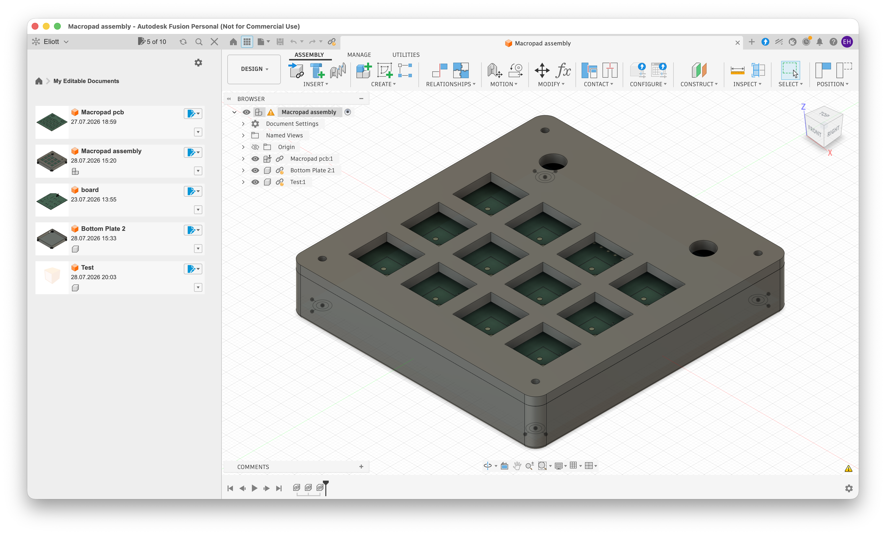
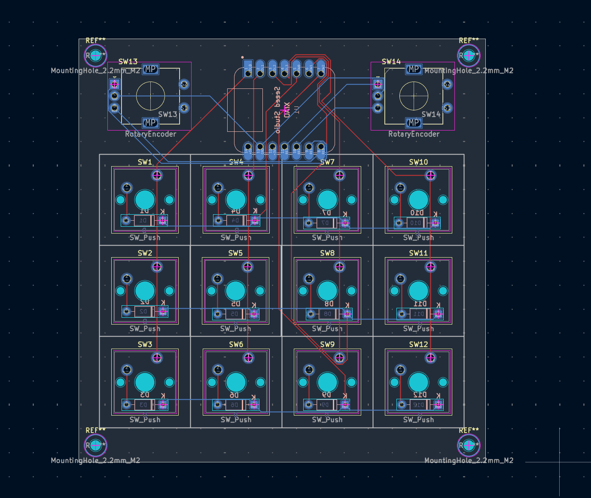
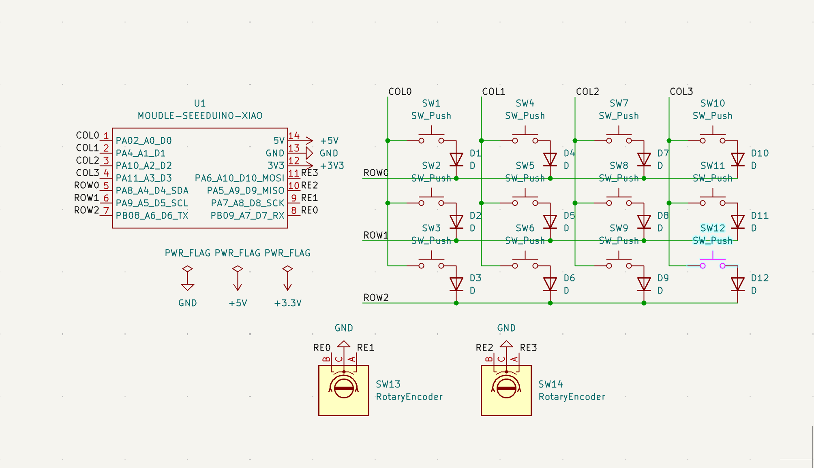

A small macropod featuring 12 programmable keys and 2 rotary encoders. Uses a sandwich design to hold down the pcb and 12 mx switches with a top black plate. 
Keys are programmed to optimise coding and make it easier to access things that can be on the harder side of things to do with a normal keyboard, offering quickly accessible shortcuts for key functions

**Materials for 2 macropads** *add 1 microcontroller and 2 rotary encoders and 2 encoder knobs for 1 more*

| Item | Qty | Description | Vendor | Est. Price
| :--- | :---: | :--- | :--- | :---: |
| Custom PCB | 5 | 2-Layer Macropad PCB | JLCPCB | €1.76 |
| Top Plate | 5 | 1.6mm top plate | JLCPCB | €6.49 |
| Microcontroller | 1 | MOUDLE-SEEDUINO-XIAO | [AliExpress](https://de.aliexpress.com/item/1005008200917480.html?spm=a2g0o.productlist.0.0.2d441e82rvSIy1&mp=1&pdp_npi=6%40dis%21CHF%21CHF+7.33%21CHF+0.93%21%21CHF+0.93%21%21%21%400b0fe08917956215709601260e0eb7%2112000058130698585%21ct%21CH%21-1%21%211%210%21&gatewayAdapt=glo2deu) | €0.93 |
| Switches | 30 | Cherry MX-style mechanical switches | [AliExpress](https://de.aliexpress.com/item/1005004740495816.html?spm=a2g0o.productlist.main.3.79a55697ab3ygs&algo_pvid=8d86aca2-5c8e-4bdc-80b4-5df8e22c230b&algo_exp_id=8d86aca2-5c8e-4bdc-80b4-5df8e22c230b-2&pdp_ext_f=%7B%22order%22%3A%2216%22%2C%22eval%22%3A%221%22%2C%22fromPage%22%3A%22search%22%7D&pdp_npi=6%40dis%21CHF%216.76%215.99%21%21%217.93%217.03%21%4021038c6f17956220504502874e13ca%2112000036816410320%21sea%21CH%210%21ABX%211%210%21n_tag%3A-29910%3Bd%3A65e4ded%3Bm03_new_user%3A-29895&curPageLogUid=SLIC4ipFNYtl&utparam-url=scene%3Asearch%7Cquery_from%3A%7Cx_object_id%3A1005004740495816%7C_p_origin_prod%3A) | €7.91 |
| Rotary Encoders | 3 | EC11 Encoders | [AliExpress](https://de.aliexpress.com/item/1005007644083514.html?spm=a2g0o.productlist.0.0.2d441e82rvSIy1&mp=1&pdp_npi=6%40dis%21CHF%21CHF+2.57%21CHF+0.93%21%21CHF+0.93%21%21%21%400b0fe08917956215709601260e0eb7%2112000041630839410%21ct%21CH%21-1%21%211%210%21&gatewayAdapt=glo2deu) | €0.93 |
| Diodes | 100 | 1N4148 Diodes | [AliExpress](https://de.aliexpress.com/item/1005012378799428.html?spm=a2g0o.productlist.main.1.5a95c80dic6ZB3&algo_pvid=4665a561-675e-414a-80e2-b60a568e8eae&algo_exp_id=4665a561-675e-414a-80e2-b60a568e8eae-0&pdp_ext_f=%7B%22order%22%3A%228%22%2C%22eval%22%3A%221%22%2C%22fromPage%22%3A%22search%22%7D&pdp_npi=6%40dis%21CHF%216.73%210.93%21%21%2152.54%217.22%21%400b0fe40d17956222567968830e0ed1%2112000058243696429%21sea%21CH%210%21ABX%211%210%21n_tag%3A-29910%3Bd%3A65e4ded%3Bm03_new_user%3A-29895%3BpisId%3A5000000219526378&curPageLogUid=f78OxLxKtNpj&utparam-url=scene%3Asearch%7Cquery_from%3A%7Cx_object_id%3A1005012378799428%7C_p_origin_prod%3A) | €0.93 |
| Keycaps & Knobs | 22 | 20x 1u Keycaps + 2x Encoder Knobs | [AliExpress](https://de.aliexpress.com/item/1005004981162700.html?spm=a2g0o.detail.0.0.5ea6sbBjsbBjSi&mp=1&pdp_npi=6%40dis%21CHF%21CHF+4.48%21CHF+3.93%21%21CHF+3.93%21%21%21%400b88ab8a17956220814998505e100a%2112000031229370147%21ct%21CH%21-1%21%211%210%21&gatewayAdapt=glo2deu), [AliExpress](https://de.aliexpress.com/item/1005007969022294.html?spm=a2g0o.cart.0.0.58ee4ae4uLiDjA&mp=1&pdp_npi=6%40dis%21CHF%21CHF+1.93%21CHF+1.93%21%21CHF+1.93%21%21%21%4021038a9c17853298451545926e0ece%2112000043070186687%21ct%21CH%218308305052%21%214%210%21&gatewayAdapt=glo2deu) | €7.27 |
| Case Hardware | 8 | M2 Brass Standoffs + M2 Screws | [AliExpress](https://de.aliexpress.com/item/1005008512900059.html?spm=a2g0o.cart.0.0.58ee4ae4coIEGW&mp=1&pdp_npi=6%40dis%21CHF%21CHF+2.65%21CHF+2.65%21%21CHF+2.65%21%21%21%4021038a9c17853299081077258e0ece%2112000045495593375%21ct%21CH%218308305052%21%211%210%21&gatewayAdapt=glo2deu), [AliExpress](https://www.aliexpress.com/p/shoppingcart/index.html?spm=a2g0o.home.header.1.32097a8bodTR2p), [AliExpress](https://de.aliexpress.com/item/4000314663724.html?spm=a2g0o.cart.0.0.58ee4ae4coIEGW&mp=1&pdp_npi=6%40dis%21CHF%21CHF+1.04%21CHF+0.66%21%21CHF+0.66%21%21%21%4021038a9c17853299081077258e0ece%2110000001297126740%21ct%21CH%218308305052%21%211%210%21&gatewayAdapt=glo2deu) | €6.37 |
| **Total Estimated Cost** | | *(Excluding Shipping)* | | **32.91** |
| **Shipping costs** | | | | |
| AliExpress | | | AliExpress | €0 |
| JLCPCB | | | JLCPCB | €10.61 |
 | **Final Estimated Cost** | | | | **€43.52** |

