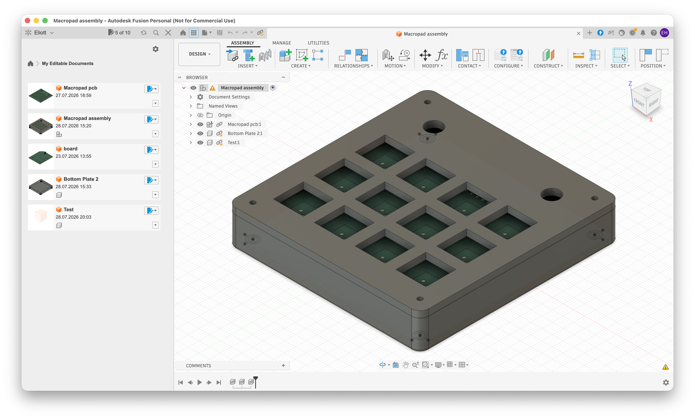
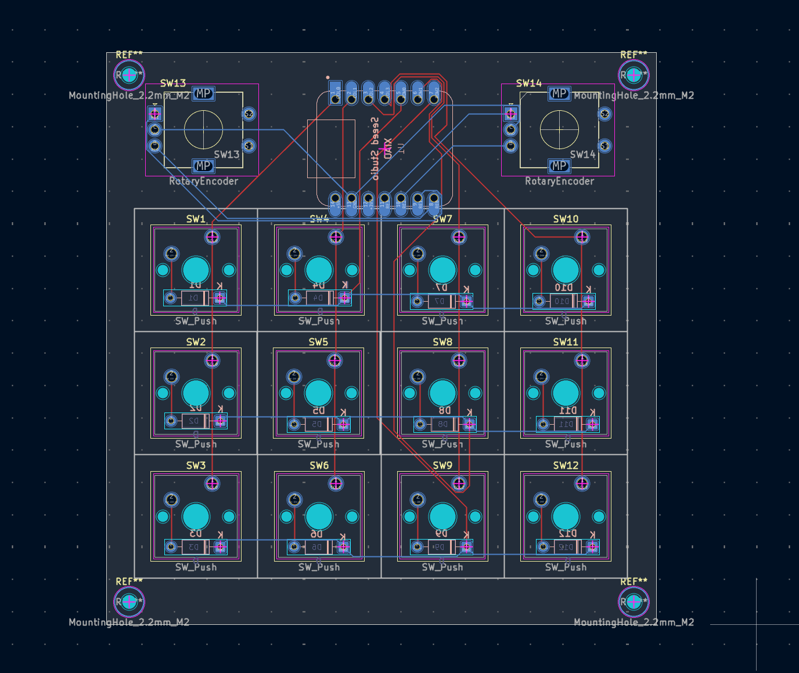
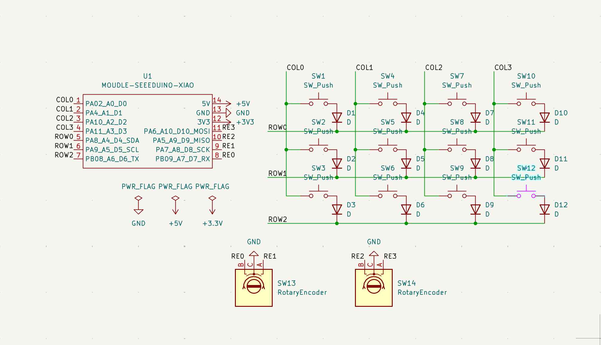

A small macropod featuring 12 programmable keys and 2 rotary encoders. Uses a sandwich design to hold down the pcb and 12 mx switches with a top black plate. 
Keys are programmed to optimise coding and make it easier to access things that can be on the harder side of things to do with a normal keyboard, offering quickly accessible shortcuts for key functions

**Materials for 2 macropads** *add 1 microcontroller and 2 rotary encoders and 2 encoder knobs for 1 more*

| Item | Qty | Description | Vendor | Est. Price
| :--- | :---: | :--- | :--- | :---: |
| Custom PCB | 5 | 2-Layer Macropad PCB | JLCPCB | €1.76 |
| Top Plate | 5 | 1.6mm top plate | JLCPCB | €6.49 |
| Microcontroller | 2 | MOUDLE-SEEDUINO-XIAO | [AliExpress](https://de.aliexpress.com/item/1005008200917480.html?spm=a2g0o.cart.0.0.58ee4ae4orNWIU&mp=1&pdp_npi=6%40dis%21CHF%21CHF+13.23%21CHF+9.39%21%21CHF+9.39%21%21%21%402103842a17853297041287864e21a0%2112000058130698584%21ct%21CH%218308305052%21%211%210%21&gatewayAdapt=glo2deu) | €9.39 |
| Switches | 50 | Cherry MX-style mechanical switches | [AliExpress](https://de.aliexpress.com/item/1005012075309061.html?spm=a2g0o.cart.0.0.58ee4ae4orNWIU&mp=1&pdp_npi=6%40dis%21CHF%21CHF+30.41%21CHF+13.99%21%21CHF+13.99%21%21%21%402103842a17853297041287864e21a0%2112000057470352728%21ct%21CH%218308305052%21%211%210%21&gatewayAdapt=glo2deu) | €13.99 |
| Rotary Encoders | 4 | EC11 Encoders | [AliExpress](https://de.aliexpress.com/item/1005007644083514.html?spm=a2g0o.cart.0.0.58ee4ae4orNWIU&mp=1&pdp_npi=6%40dis%21CHF%21CHF+3.12%21CHF+3.12%21%21CHF+3.12%21%21%21%402103842a17853297041287864e21a0%2112000041630839411%21ct%21CH%218308305052%21%211%210%21&gatewayAdapt=glo2deu) | €3.12 |
| Diodes | 100 | 1N4148 Diodes | [AliExpress](https://de.aliexpress.com/item/1005008905065392.html?spm=a2g0o.cart.0.0.58ee4ae4uLiDjA&mp=1&pdp_npi=6%40dis%21CHF%21CHF+1.30%21CHF+1.25%21%21CHF+1.25%21%21%21%4021038a9c17853298451545926e0ece%2112000047140855094%21ct%21CH%218308305052%21%211%210%21&gatewayAdapt=glo2deu) | €1.25 |
| Keycaps & Knobs | 44 | 40x 1u Keycaps + 4x Encoder Knobs | [AliExpress](https://de.aliexpress.com/item/1005007572331245.html?spm=a2g0o.cart.0.0.58ee4ae4uLiDjA&mp=1&pdp_npi=6%40dis%21CHF%21CHF+4.69%21CHF+4.69%21%21CHF+4.69%21%21%21%4021038a9c17853298451545926e0ece%2112000041346783256%21ct%21CH%218308305052%21%212%210%21&gatewayAdapt=glo2deu), [AliExpress](https://de.aliexpress.com/item/1005007969022294.html?spm=a2g0o.cart.0.0.58ee4ae4uLiDjA&mp=1&pdp_npi=6%40dis%21CHF%21CHF+1.93%21CHF+1.93%21%21CHF+1.93%21%21%21%4021038a9c17853298451545926e0ece%2112000043070186687%21ct%21CH%218308305052%21%214%210%21&gatewayAdapt=glo2deu) | €17.1 |
| Case Hardware | 8 | M2 Brass Standoffs + M2 Screws | [AliExpress](https://de.aliexpress.com/item/1005008512900059.html?spm=a2g0o.cart.0.0.58ee4ae4coIEGW&mp=1&pdp_npi=6%40dis%21CHF%21CHF+2.65%21CHF+2.65%21%21CHF+2.65%21%21%21%4021038a9c17853299081077258e0ece%2112000045495593375%21ct%21CH%218308305052%21%211%210%21&gatewayAdapt=glo2deu), [AliExpress](https://www.aliexpress.com/p/shoppingcart/index.html?spm=a2g0o.home.header.1.32097a8bodTR2p), [AliExpress](https://de.aliexpress.com/item/4000314663724.html?spm=a2g0o.cart.0.0.58ee4ae4coIEGW&mp=1&pdp_npi=6%40dis%21CHF%21CHF+1.04%21CHF+0.66%21%21CHF+0.66%21%21%21%4021038a9c17853299081077258e0ece%2110000001297126740%21ct%21CH%218308305052%21%211%210%21&gatewayAdapt=glo2deu) | €6.37 |
| **Total Estimated Cost** | | *(Excluding Shipping)* | | **59.74** |
| **Shipping costs** | | | | |
| AliExpress | | | AliExpress | €8.68 |
| JLCPCB | | | JLCPCB | €10.61 |
 | **Final Estimated Cost** | | | | **€79.03** |

